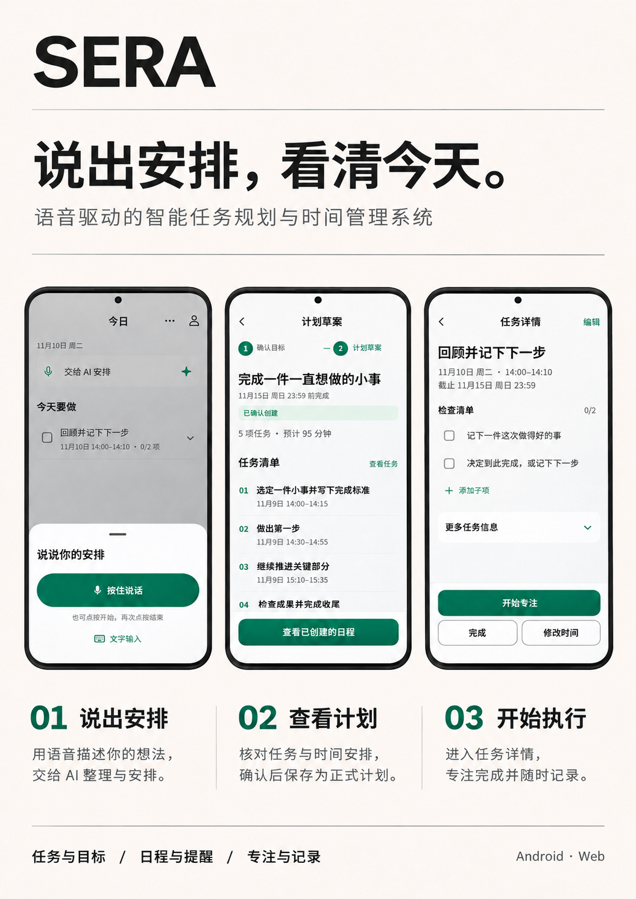
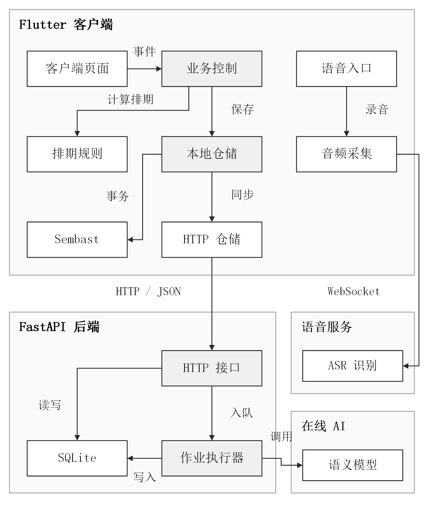

# SERA 语音驱动的智能任务规划与时间管理系统

SERA 支持用一句语音完成任务与日程录入：AI 将口语整理为清晰的标题、说明和时间信息，系统生成可核对的安排，确认后保存日程并按提醒规则通知。用户无需逐项填写日期、起止时间和用时。任务规划还结合工作日、依赖、每日预算和已有日程计算安排，Android 与 Web 共享 Flutter 实现。

<p align="center"></p>

[完整案例：从一句语音到带提醒的日程](project-docs/voice-to-schedule/README.md)

## 主要功能

| 入口 | 功能 |
| --- | --- |
| 今日 | 当日任务、语音输入、完成与撤销、专注记录 |
| 计划 | 任务与目标、草案编辑、确认提交、重新排期 |
| 日程 | 日／周／月视图、日程编辑、日历同步与提醒 |
| 社区 | 图文分享、评论、点赞、官方活动与参与 |
| Web 管理后台 | 内容管理、权限分配、操作审计和运营统计 |

在线 AI 负责理解与任务拆解，Dart 领域服务负责约束排期。本地工作区与待同步操作通过 Sembast 事务保存，服务端以对象版本与幂等收据提交整批修改。

## 系统架构



| 部分 | 技术 |
| --- | --- |
| 客户端 | Flutter、Dart、Provider / ChangeNotifier、go_router |
| 数据访问 | Dio、Sembast、SQLite WAL |
| 服务端 | Python、FastAPI、持久作业 worker |
| 语音 | sherpa-onnx Zipformer、16 kHz PCM16 流式识别 |
| 部署 | Caddy、Docker Compose |

## 本机运行

开发基线为 Flutter 3.47.2、Dart 3.13.2、Python 3.11 和 JDK 21。准备 Flutter、Python 与 Android SDK 后，在 PowerShell 中执行：

```powershell
git clone https://github.com/Darssal/SERA.git
Set-Location SERA/sera_flutter
./scripts/setup.ps1 -SkipSigning
./scripts/start-fullstack.ps1 -AiKeyFile C:/private/siliconflow-key.txt
```

`setup.ps1` 安装锁定依赖并下载校验后的语音模型。在线语义理解使用自行配置的 SiliconFlow 凭据；启动后打开 <http://127.0.0.1:8787/>。服务进程随启动命令管理，按 Ctrl+C 结束。

客户端检查与 Web 构建：

```powershell
flutter analyze --no-pub
flutter test
./scripts/build.ps1 -Target web
```

Android 的设备选择、签名与运行方法见[应用说明](sera_flutter/README.md)，容器配置见[部署说明](sera_flutter/deploy/README.md)。

## 源码与文档

| 路径 | 内容 |
| --- | --- |
| `sera_flutter/lib/` | 界面、控制器、领域规则、仓储和平台适配 |
| `sera_flutter/backend/` | HTTP 接口、账户存储、AI 作业和语音服务 |
| `sera_flutter/test/`、`integration_test/` | 客户端行为与集成测试 |
| `sera_flutter/deploy/` | Compose、Caddy、备份与恢复脚本 |
| `project-docs/diagrams/` | 系统结构与业务流程图、可编辑 Visio 源文件 |
| `project-docs/images/` | 应用使用海报 |

进一步阅读：[架构与数据边界](sera_flutter/docs/ARCHITECTURE.md) · [接口契约](sera_flutter/docs/API.md) · [运营统计](sera_flutter/docs/ADMIN_ANALYTICS.md) · [图稿目录](project-docs/README.md)。

## 版本与验证记录

当前源码版本为 **2.2.1+33**。2026-11-10 的开发记录包含 Flutter 1063 项通过、后端既有回归 467 项通过、统计接口 18 项通过；执行环境、分项结果和浏览器验证见[版本验收](sera_flutter/docs/ADMIN_ANALYTICS_QA_20261110.md)。Android 上一有效签名构建为 2.2.0+32，历史设备与构建记录见应用说明。

仓库保存源码、配置示例、字体许可与项目文档；模型权重由下载脚本初始化，本机账户数据和签名材料独立保存。
