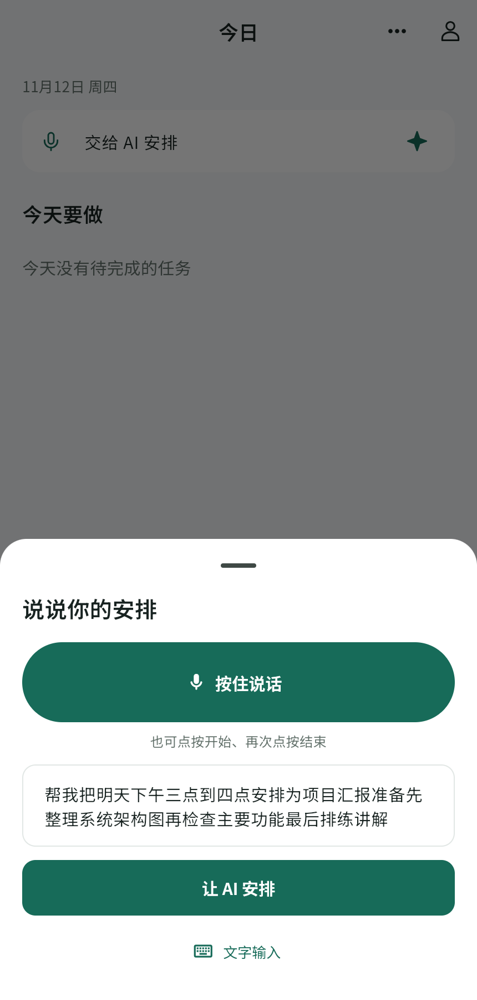
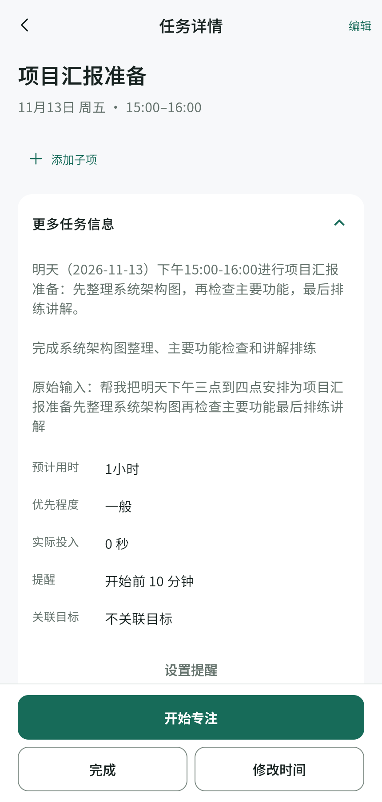

# 从一句语音到带提醒的日程

SERA 将自然语言整理为规范化的任务内容和时间字段。用户核对后保存，系统创建日程并沿用提醒规则，减少逐项填写标题、说明、日期、起止时间和用时的操作。

本案例于 2026 年 11 月 12 日运行，使用 2.2.1+33 Web 构建、实际 sherpa-onnx 语音识别服务与在线 GLM-5.3-Flash。中文合成语音通过浏览器麦克风测试通道输入；提醒使用受控浏览器时钟触发验证。

## 1 说出安排

“帮我把明天下午三点到四点安排为项目汇报准备。先整理系统架构图，再检查主要功能，最后排练讲解。”

从今日页选择“交给 AI 安排”，录音后选择“让 AI 安排”。[播放或下载案例语音](demo-input.wav)。

## 2 查看 AI 整理结果

AI 将连续口语整理为标题、说明、完成标准和时间字段；“明天下午三点到四点”转换为 2026 年 11 月 13 日 15:00—16:00。

| 字段 | 实际生成结果 |
| --- | --- |
| 标题 | 项目汇报准备 |
| 内容 | 先整理系统架构图，再检查主要功能，最后排练讲解 |
| 日期 | 2026-11-13 |
| 起止时间 | 15:00—16:00 |
| 预计用时 | 60 分钟 |
| 预期结果 | 完成系统架构图整理、主要功能检查和讲解排练 |

## 3 核对并保存

选择“编辑任务”后，标题、说明、60 分钟用时和起止时间已填入表单。本案例未手动修改这些字段，直接核对并选择“保存任务”。

## 4 查看日程与提醒

11 月 13 日的日程页出现“项目汇报准备 15:00—16:00”。任务详情保留整理后的说明，并使用“开始前 10 分钟”提醒规则，对应提醒时间为 14:50。

## 5 验证提醒触发

浏览器已授权通知。将受控时钟推进至 11 月 13 日 14:50 后，Service Worker 返回已显示通知：标题为“项目汇报准备”，正文为“计划 15:00 开始，给重要的事留一点时间。”，通知关联该任务详情。

本案例完成语音识别、在线语义理解、表单预填、正式保存、日程展示、提醒注册和通知触发。用户只需表达安排、核对结果并确认保存。

[查看本次结构化结果](result.json) · [返回项目首页](../../README.md)
